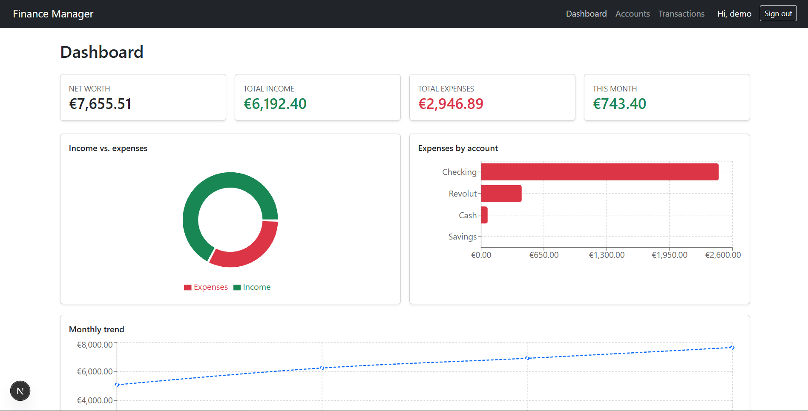
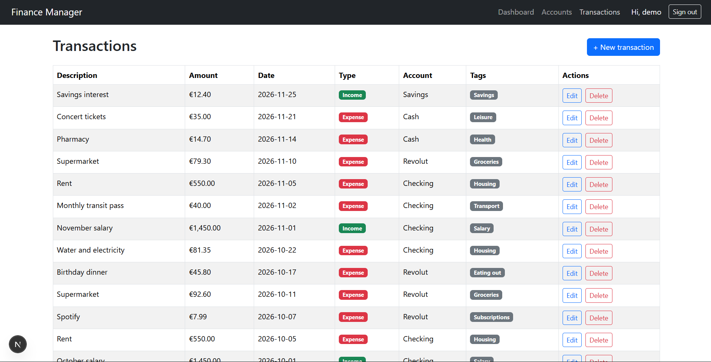
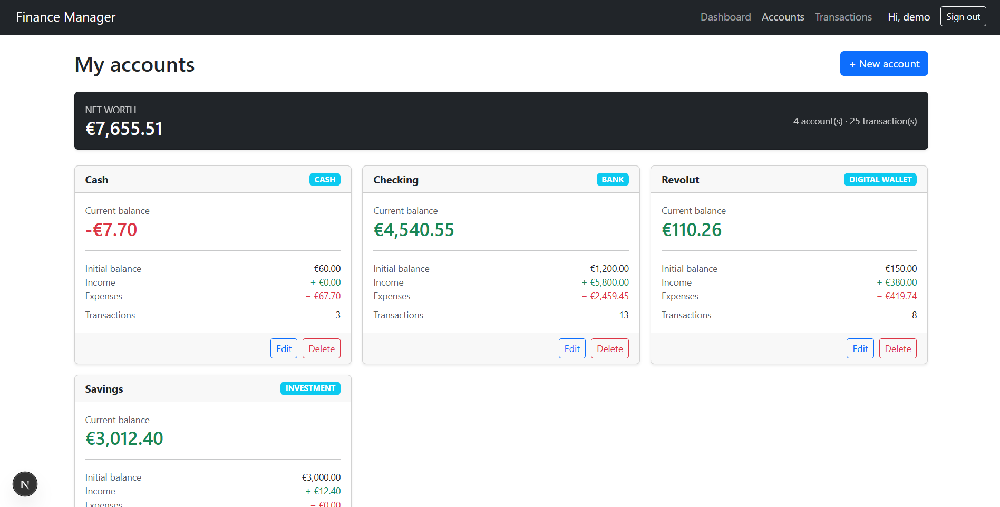
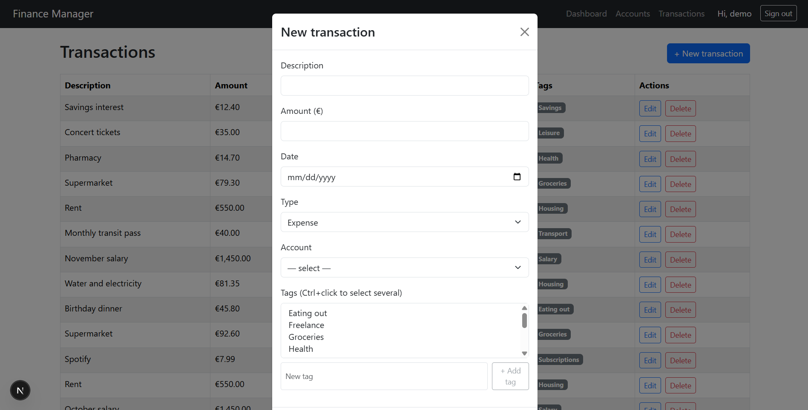

# Finance Manager

**Personal finance manager: accounts, income and expenses, tags, and a dashboard with charts.**


A full-stack web app for tracking personal money across several accounts (bank, digital wallet, card, cash, investments). Users sign up, sign in and only ever see their own data. Every transaction can be tagged, and the dashboard shows where the money is and how it changed month by month.

> Academic project · CTeSP TPSI · Instituto Politécnico de Tomar (2025/2026).

<!--
  SCREENSHOTS — save images in docs/screenshots/ and uncomment the table below.

| Dashboard | Transactions |
|:---:|:---:|
|  |  |
| **Accounts** | **New transaction** |
|  |  |
-->

## Features

- **Authentication**: sign up and sign in with Strapi Users & Permissions (JWT)
- **Accounts**: bank, digital wallet, card, cash or investment, each with its own initial balance
- **Transactions**: create, edit and delete income and expenses, with date, amount and description
- **Tags**: tag transactions and create new tags straight from the form
- **Dashboard**:
  - KPI cards: net worth, total income, total expenses and this month's balance
  - Income vs. expenses chart
  - Monthly trend with a running balance
  - Expenses by account
- **Per-user data isolation**: every account, transaction and tag belongs to a user, and the API only lets each user read or change their own records

## Architecture

```
gestor-financas/
├── frontend/   Next.js 16 (App Router) · React 19 · React-Bootstrap · Recharts
└── backend/    Strapi 5 headless CMS · REST API · SQLite
```

```
Browser ──► Next.js frontend ──REST + JWT──► Strapi API ──► SQLite
```

Some design decisions:

- **Balances are never stored.** An account's balance is always derived from its initial balance plus its transactions (`frontend/lib/finance.js`), so it can never drift out of sync.
- **Business logic is separate from UI and API.** `lib/finance.js` holds pure functions (totals, monthly grouping, currency formatting); `lib/strapi.js` handles every API call in one place, including pagination.
- **Ownership is enforced on the server**, not just hidden in the UI. One shared controller factory (`backend/src/utils/owned-controller.js`) filters every query by the logged-in user, sets the owner on create, and returns `403` on anyone else's records.
- **Zero-click setup.** On startup, `backend/src/index.js` grants the Authenticated role access to the app's API, so there's nothing to configure in the admin panel.

### Data model

| Content type | Fields |
|---|---|
| `account` | name, type (`bank`, `digital_wallet`, `card`, `cash`, `investment`), initial balance, transactions, owner |
| `transaction` | description, amount, date, type (`income` / `expense`), account, tags, owner |
| `tag` | name, transactions, owner |

## Running locally

Requirements: **Node.js 20+** and npm.

### 1. Backend (Strapi)

```bash
cd backend
cp .env.example .env
# Fill in the secrets in .env, e.g. generate each value with:
#   node -e "console.log(require('crypto').randomBytes(32).toString('base64'))"
npm install
npm run develop
```

Strapi starts at <http://localhost:1337>. On the first run, create your admin account at <http://localhost:1337/admin> (only needed to browse the data; the app itself doesn't require it).

### 2. Frontend (Next.js)

```bash
cd frontend
cp .env.example .env.local
npm install
npm run dev
```

Open <http://localhost:3000>, sign up, create an account and start adding transactions.

## What I learned

- Building a REST backend with Strapi and **overriding its core controllers** to add authorisation rules
- Handling JWT auth on the client with React Context
- Paginating through API results so large datasets aren't silently cut off
- Shaping API data for charts with Recharts
- Keeping derived state (balances) computed instead of stored

## Author

**Victor Hugo Marcondes Lopes** · [GitHub](https://github.com/MarcondezVictor)
